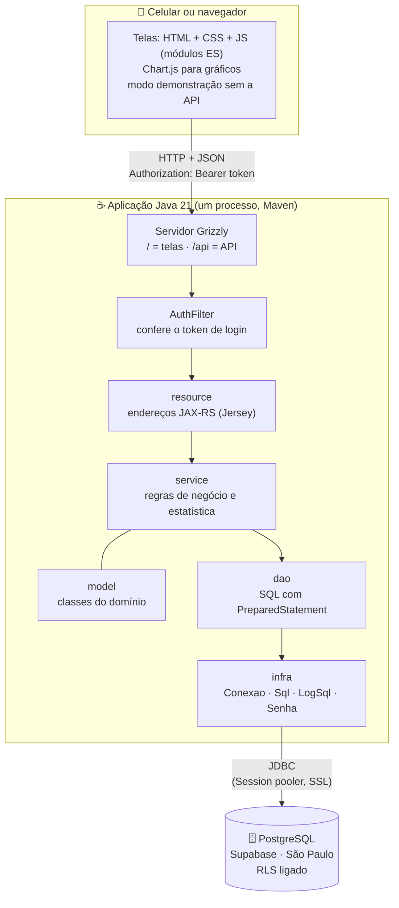
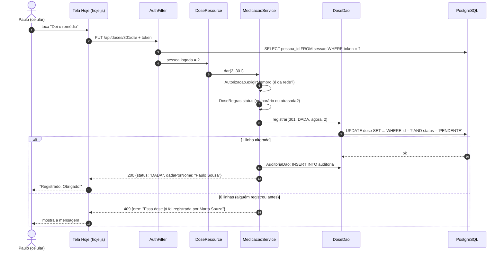

# Arquitetura

> **Versão 1 (planejada) — 13/11/2026.** Ver [[Design da Solução]] (seção 7), [[API]], [[Mapa do Código]] e [[Diagrama de Classes]].

## Visão geral

Um **único processo Java** sobe o servidor Grizzly. Ele entrega as **telas** (HTML, CSS e JS) em `/` e a **API REST** (JAX-RS com Jersey) em `/api`. O banco é **PostgreSQL no Supabase** (região São Paulo), acessado só pelo Java, via **JDBC**.

## Camadas

| Camada | Pacote | Responsabilidade | Conteúdo do curso |
|---|---|---|---|
| Telas | `web/` (HTML, CSS, JS) | Mostrar e coletar dados; celular primeiro | Fase 4: interfaces gráficas front-end não integrado |
| Recurso | `resource` | Receber a requisição HTTP, ler parâmetros e devolver JSON | Fase 5: API RESTful e JAX-RS |
| Serviço | `service` | Regras de negócio, autorização e estatística | Fases 1, 2 e 6: estatística e eficiência |
| Modelo | `model` | Classes do domínio com encapsulamento, herança e polimorfismo | Fases 2 e 3: OO |
| Acesso a dados | `dao` | Todo o SQL, sempre com `?` (PreparedStatement) | Fase 4: Java + banco (JDBC) |
| Infraestrutura | `infra` | Conexão, transação, log de SQL, senhas, filtros | Fase 3: cybersecurity |

## Uma requisição de ponta a ponta: "Dei o remédio"

O `UPDATE ... WHERE status = 'PENDENTE'` resolve o caso de **duas pessoas tocarem ao mesmo tempo**: só a primeira grava, e a segunda recebe a mensagem dizendo quem já deu o remédio.

## Decisões de arquitetura
| Decisão | Por quê |
|---|---|
| Um processo só (telas + API) | Um endereço só, sem problema de CORS e mais simples de rodar e de mostrar no vídeo |
| Jersey + Grizzly | É o que o curso ensinou (Fase 5, Cap 7); o servidor sobe pelo `main`, sem instalar Tomcat |
| JDBC puro com `PreparedStatement` | Mostra o acesso ao banco de forma transparente (vídeo técnico) e impede injeção de SQL |
| Conexões reaproveitadas (pool mínimo) | Abrir uma conexão segura até o Supabase a cada comando deixaria as telas lentas |
| Telas com modo demonstração | Permitiu construir e testar as telas num computador sem Java (ver [[Diário de Desafios]]) |
| Alertas calculados quando a tela abre | Não precisa de rotina rodando em segundo plano; a chave única evita alerta repetido |
| Supabase com RLS ligado e sem política | Fecha a API automática do Supabase; o Java acessa como dono das tabelas |
| Web responsiva, não app de loja | Custo e prazo; a API REST já serve um app futuro (ver [[Design da Solução]], seção 17) |

## Versão final (implementada)
_A preencher depois da implementação (Tarefa B5): o que mudou desde a v1 e por quê._
