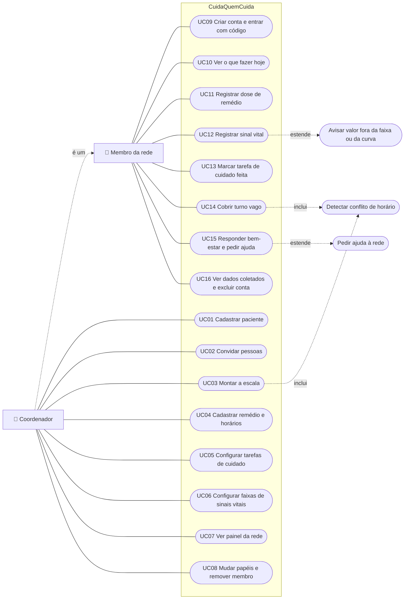

# Casos de Uso

> **Versão 1 (planejada) — 13/11/2026.** Formato das fichas segue o Lab "Documentando os casos de uso" (Fase 2). Ver [[Design da Solução]] (seção 4), [[API]] e [[Personas]].

## Atores
- **Membro da rede:** familiar ou vizinho voluntário (ex.: Paulo, Ana, João). Cuida nos turnos e registra o cuidado.
- **Coordenador:** normalmente o cuidador principal (ex.: Marta). **É também um membro** (herda todos os casos do membro) e ainda organiza a rede.
- **Sistema (relógio):** gera doses, tarefas e alertas quando uma tela é aberta.

## Diagrama

## Fichas

### UC01 — Cadastrar paciente
| Campo | Descrição |
|---|---|
| Ator | Coordenador (quem cadastra vira coordenador) |
| Pré-condição | Estar logado |
| Fluxo principal | 1. Informa nome, nascimento, condição, se precisa de 24 h e observações. 2. Informa o nome e o parentesco do responsável legal. 3. Marca a declaração de autorização. 4. O sistema grava o paciente, a rede (com a pessoa como coordenadora) e o consentimento, e mostra o código de convite. |
| Fluxos alternativos | 3a. Sem a declaração: o sistema recusa ("É preciso declarar a autorização..."). 2a. Sem responsável legal: recusa. |
| Pós-condição | Paciente e rede criados; consentimento `DADOS_PACIENTE` registrado; auditoria gravada |

### UC02 — Convidar pessoas
| Campo | Descrição |
|---|---|
| Ator | Coordenador |
| Pré-condição | Paciente cadastrado |
| Fluxo principal | 1. Abre "Pessoas da rede". 2. Vê o código de 6 caracteres. 3. Passa o código à pessoa (WhatsApp, por exemplo). |
| Fluxos alternativos | 2a. "Gerar novo código": o antigo deixa de valer. |
| Pós-condição | A pessoa pode entrar na rede (UC09) |

### UC03 — Montar a escala
| Campo | Descrição |
|---|---|
| Ator | Coordenador |
| Pré-condição | Rede com membros |
| Fluxo principal | 1. Abre a Escala da semana. 2. "+ Novo turno": escolhe a pessoa (ou "vago"), o dia, o início e o fim. 3. O sistema confere conflito de horário da pessoa em **todas** as redes. 4. Grava e mostra na semana. 5. O sistema mostra avisos de sobrecarga e períodos sem ninguém. |
| Fluxos alternativos | 2a. Fim menor que o início: o turno termina no dia seguinte (22h às 6h). 3a. Conflito: recusa com 409 e mostra os turnos que conflitam. 3b. Fim igual ao início: recusa (400). |
| Pós-condição | Turno gravado; auditoria |

### UC04 — Cadastrar remédio e horários
| Campo | Descrição |
|---|---|
| Ator | Coordenador |
| Fluxo principal | 1. Informa nome, dose, via e instruções. 2. Escolhe o tipo de horário: horários fixos, de tantas em tantas horas ou dia sim, dia não. 3. Informa os horários (ou o intervalo e a primeira dose) e o início (e o fim, se houver). 4. O sistema grava o remédio e a regra. |
| Fluxos alternativos | 3a. Intervalo fora de 1 a 24 h, ou nenhum horário: recusa. 4a. Ao editar a regra, as doses futuras ainda pendentes são refeitas pela regra nova. |
| Pós-condição | As doses passam a ser geradas automaticamente, sem duplicar |

### UC05 — Configurar tarefas de cuidado
| Campo | Descrição |
|---|---|
| Ator | Coordenador |
| Fluxo principal | 1. Informa a tarefa (ex.: "Mudar de posição"), a orientação de como fazer, a repetição (1 a 24 h) e a primeira vez. 2. Indica se é uma medição (ex.: "Medir pressão"). 3. O sistema grava. |
| Pós-condição | A tarefa aparece na tela Hoje de quem estiver no turno, inclusive de madrugada |

### UC06 — Configurar faixas de sinais vitais
| Campo | Descrição |
|---|---|
| Ator | Coordenador |
| Fluxo principal | 1. Informa o mínimo e o máximo aceitáveis de cada sinal (ex.: pressão de 90 a 150). 2. O sistema grava. |
| Fluxos alternativos | 1a. Mínimo maior que o máximo: recusa. |

### UC07 — Ver painel da rede
| Campo | Descrição |
|---|---|
| Ator | Coordenador (o membro não vê) |
| Fluxo principal | 1. Abre Mais → Painel da rede. 2. Vê a adesão aos remédios, quem carrega o cuidado, a média móvel de horas, a chance de atraso à noite, média, mediana e moda, e a correlação entre noites e sobrecarga. |
| Fluxos alternativos | 2a. Sem dados suficientes: aparece "Dados insuficientes". 2b. Estatísticas da Zarit usam só quem compartilhou. |

### UC08 — Mudar papéis e remover membro
| Campo | Descrição |
|---|---|
| Ator | Coordenador |
| Fluxo principal | 1. Em Pessoas da rede, torna alguém coordenador ou tira a coordenação, ou remove da rede. |
| Fluxos alternativos | 1a. Tentar deixar a rede sem coordenador: recusa. 1b. Remover a si mesmo: recusa (usar "Excluir minha conta"). |
| Pós-condição | Os registros feitos pela pessoa removida continuam |

### UC09 — Criar conta e entrar com código
| Campo | Descrição |
|---|---|
| Ator | Membro |
| Fluxo principal | 1. Cria a conta (nome, e-mail, senha de 8 caracteres ou mais) e aceita o termo. 2. Entra. 3. Escolhe "Entrar com código", digita o código e o vínculo. 4. O sistema inclui a pessoa como membro. |
| Fluxos alternativos | 1a. E-mail já usado: 409. 1b. Sem aceite do termo: recusa. 3a. Código inexistente: 404. 3b. Já é membro: 409. |

### UC10 — Ver o que fazer hoje
| Campo | Descrição |
|---|---|
| Ator | Membro |
| Fluxo principal | 1. Abre o sistema: a tela Hoje mostra os alertas, o turno atual e a linha do tempo de remédios e tarefas do turno, cada um com um botão. |
| Fluxos alternativos | 1a. Sem turno agora: mostra o próximo turno e as pendências do dia. 1b. Mais de uma rede: escolhe o paciente no topo. |

### UC11 — Registrar dose de remédio
| Campo | Descrição |
|---|---|
| Ator | Membro |
| Pré-condição | Dose pendente |
| Fluxo principal | 1. Toca "Dei o remédio". 2. O sistema grava quem deu e quando, como **dada** (até 30 min depois do horário) ou **atrasada**. |
| Fluxos alternativos | 1a. "Não foi dado": informa o motivo. 2a. Outra pessoa registrou antes: 409 com o nome de quem registrou. |
| Pós-condição | Adesão atualizada; auditoria |

### UC12 — Registrar sinal vital
| Campo | Descrição |
|---|---|
| Ator | Membro |
| Fluxo principal | 1. Na tarefa "Medir pressão" (ou em Mais → Sinais vitais), toca "Registrar" e digita o valor. 2. O sistema grava e confere a faixa e o padrão do paciente. |
| Extensão | 2a. Fora da faixa ou fora da curva (\|z\| > 2): avisa quem está de turno e os coordenadores. |
| Fluxos alternativos | 1a. Valor zero ou negativo: recusa. |

### UC13 — Marcar tarefa de cuidado feita
| Campo | Descrição |
|---|---|
| Ator | Membro |
| Fluxo principal | 1. Abre "Como fazer", se precisar. 2. Toca "Feito". 3. O sistema grava quem fez e quando. |
| Fluxos alternativos | 3a. Alguém marcou antes: 409. |

### UC14 — Cobrir turno vago
| Campo | Descrição |
|---|---|
| Ator | Membro |
| Fluxo principal | 1. Vê o alerta "Domingo 22h–6h está sem ninguém". 2. Toca "Posso cobrir". 3. O sistema confere conflito e grava o turno para a pessoa. |
| Fluxos alternativos | 3a. A pessoa já tem turno nesse horário: 409. 2a. Turno vago criado pelo coordenador: botão "Assumir". |

### UC15 — Responder bem-estar e pedir ajuda
| Campo | Descrição |
|---|---|
| Ator | Membro (todo cuidador) |
| Fluxo principal | 1. Abre Bem-estar e responde às 12 perguntas, uma por vez, e às 2 de sono. 2. O sistema calcula a pontuação (0 a 48) e a faixa. 3. Mostra o resultado, que só a pessoa vê. |
| Extensão | 3a. Faixa alta: mostra CVV 188, UBS e CAPS e oferece "Pedir ajuda à rede", que avisa os membros sem mostrar a pontuação. |
| Fluxos alternativos | A pessoa pode compartilhar a pontuação com o coordenador, por rede, ou apagar uma avaliação. |

### UC16 — Ver dados coletados e excluir conta
| Campo | Descrição |
|---|---|
| Ator | Membro |
| Fluxo principal | 1. Abre "Dados coletados" e vê o que é guardado, por quê, quem vê e por quanto tempo. 2. Em "Minha conta", vê os próprios dados e pode excluir a conta. |
| Fluxos alternativos | 2a. Único coordenador de uma rede com outros membros: recusa até passar a coordenação. |
| Pós-condição | Pessoa anonimizada; avaliações Zarit apagadas; registros de cuidado mantidos como "Pessoa removida" |

## Versão final (implementada)
_A preencher depois da implementação (Tarefa B5)._
