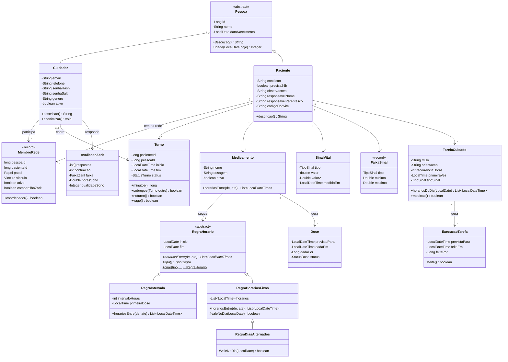
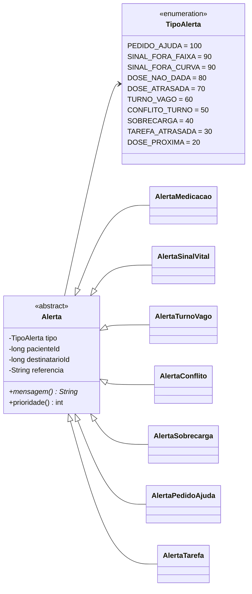
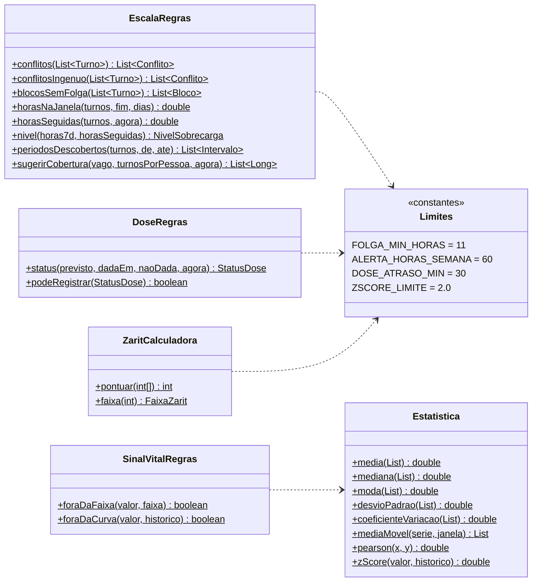

# Diagrama de Classes

> **Versão 1 (planejada) — 13/11/2026.** Ver [[Arquitetura]], [[Diagrama do Banco]] e [[Mapa do Código]].
> Conteúdo do curso: Fase 2 (diagrama de classes, classes e métodos, "quando as partes se conversam") e Fase 3 (encapsulamento, herança e polimorfismo).

## Modelo do domínio (`model`)

## Alertas (polimorfismo)

Cada alerta monta a **própria mensagem**. O serviço trata todos como `Alerta` e só chama `mensagem()`.

## Regras de negócio puras (`service`)

Classes sem estado, com métodos estáticos, testadas por JUnit. Detalhes em [[Regras de Negócio]].

## Onde estão os conceitos de OO
| Conceito | Onde | Por quê |
|---|---|---|
| **Encapsulamento** | Todos os atributos são privados; os construtores e setters validam (ex.: `Turno` recusa fim antes do início; `Pessoa` recusa nome vazio) | O objeto nunca fica num estado inválido |
| **Herança** | `Pessoa` → `Cuidador`, `Paciente`; `RegraHorariosFixos` → `RegraDiasAlternados` | Reaproveitar o que é comum |
| **Classe abstrata** | `Pessoa`, `RegraHorario`, `Alerta` | Só existem objetos dos tipos concretos |
| **Polimorfismo** | `RegraHorario.horariosEntre()`, `Alerta.mensagem()`, `Pessoa.descricao()` | O serviço chama o mesmo método e cada tipo responde do seu jeito |
| **Método gancho** | `RegraHorariosFixos.valeNoDia()`, sobrescrito em `RegraDiasAlternados` | A subclasse troca só uma decisão |
| **Records** | `MembroRede`, `FaixaSinal`, DTOs da API | Dados imutáveis, sem código repetido |
| **Enums com dados** | `TipoSinal` (nome e unidade), `TipoAlerta` (prioridade) | Constantes com significado |

## Versão implementada, 14/11/2026

A compilação e os 64 testes confirmaram as classes de domínio e os serviços usados nas regras de escala, medicação, sinais, Zarit e estatística. O redesenho manteve as assinaturas Java e as chamadas descritas no [[API|Contrato da API]].
