# Diagrama do Banco (DER)

> **Versão 1 (planejada) — 13/11/2026.** O DER final é gerado do banco real pelo DBeaver, depois da implementação, e vai para a seção "Versão final" no fim desta nota.

Banco **PostgreSQL** (Supabase, região São Paulo). Scripts em `banco/`: `01-criar-tabelas.sql` (estrutura), `02-ligar-rls.sql` (segurança) e `03-dados-demo.sql` (dados simulados). Ver [[Design da Solução]] (seção 8), [[API]] e [[Regras de Negócio]].

```mermaid
erDiagram
    PESSOA ||--o{ MEMBRO_REDE : "participa de"
    PACIENTE ||--o{ MEMBRO_REDE : "tem na rede"
    PESSOA ||--o{ CONSENTIMENTO : "aceita"
    PACIENTE |o--o{ CONSENTIMENTO : "é objeto de"
    PESSOA ||--o{ SESSAO : "abre"
    PACIENTE ||--o{ TURNO : "é cuidado em"
    PESSOA |o--o{ TURNO : "cobre"
    PACIENTE ||--o{ MEDICAMENTO : "usa"
    MEDICAMENTO ||--|| REGRA_HORARIO : "segue"
    MEDICAMENTO ||--o{ DOSE : "gera"
    PESSOA |o--o{ DOSE : "registra"
    PACIENTE ||--o{ SINAL_VITAL : "tem medido"
    PESSOA |o--o{ SINAL_VITAL : "mede"
    PACIENTE ||--o{ FAIXA_SINAL : "tem limites"
    PACIENTE ||--o{ TAREFA_CUIDADO : "tem protocolo"
    TAREFA_CUIDADO ||--o{ EXECUCAO_TAREFA : "gera"
    PESSOA |o--o{ EXECUCAO_TAREFA : "faz"
    PESSOA ||--o{ AVALIACAO_ZARIT : "responde"
    AVALIACAO_ZARIT ||--|{ RESPOSTA_ZARIT : "contém 12"
    PACIENTE ||--o{ ALERTA : "origina"
    PESSOA ||--o{ ALERTA : "recebe"
    PESSOA |o--o{ AUDITORIA : "executa"

    PESSOA {
        bigint id PK
        varchar nome
        varchar email UK
        varchar senha_hash
        varchar senha_salt
        varchar telefone
        date data_nascimento
        varchar genero
        boolean ativo
        timestamp criado_em
    }
    PACIENTE {
        bigint id PK
        varchar nome
        date data_nascimento
        varchar condicao
        boolean precisa_24h
        text observacoes
        varchar responsavel_nome
        varchar responsavel_parentesco
        char codigo_convite UK
        timestamp criado_em
    }
    MEMBRO_REDE {
        bigint pessoa_id PK, FK
        bigint paciente_id PK, FK
        varchar papel
        varchar vinculo
        boolean ativo
        boolean compartilha_zarit
        timestamp desde
    }
    CONSENTIMENTO {
        bigint id PK
        bigint pessoa_id FK
        bigint paciente_id FK
        varchar tipo
        varchar versao_termo
        varchar responsavel_nome
        timestamp aceito_em
    }
    SESSAO {
        varchar token PK
        bigint pessoa_id FK
        timestamp expira_em
    }
    TURNO {
        bigint id PK
        bigint paciente_id FK
        bigint pessoa_id FK "NULL = vago"
        timestamp inicio
        timestamp fim
        varchar status
    }
    MEDICAMENTO {
        bigint id PK
        bigint paciente_id FK
        varchar nome
        varchar dosagem
        varchar via
        varchar instrucoes
        boolean ativo
    }
    REGRA_HORARIO {
        bigint id PK
        bigint medicamento_id FK, UK
        varchar tipo
        int intervalo_horas
        time primeira_dose
        varchar horarios
        date inicio
        date fim
    }
    DOSE {
        bigint id PK
        bigint medicamento_id FK
        timestamp previsto_para
        timestamp dada_em
        bigint dada_por FK
        varchar status
        varchar observacao
    }
    SINAL_VITAL {
        bigint id PK
        bigint paciente_id FK
        varchar tipo
        numeric valor
        numeric valor2
        timestamp medido_em
        bigint medido_por FK
    }
    FAIXA_SINAL {
        bigint paciente_id PK, FK
        varchar tipo PK
        numeric minimo
        numeric maximo
    }
    TAREFA_CUIDADO {
        bigint id PK
        bigint paciente_id FK
        varchar titulo
        text orientacao
        int recorrencia_horas
        time primeira_vez
        varchar tipo_sinal "preenchido = medição"
        boolean ativa
    }
    EXECUCAO_TAREFA {
        bigint id PK
        bigint tarefa_id FK
        timestamp prevista_para
        timestamp feita_em
        bigint feita_por FK
    }
    AVALIACAO_ZARIT {
        bigint id PK
        bigint pessoa_id FK
        timestamp respondida_em
        int pontuacao
        varchar faixa
        numeric horas_sono
        int qualidade_sono
    }
    RESPOSTA_ZARIT {
        bigint avaliacao_id PK, FK
        int item PK
        int valor
    }
    ALERTA {
        bigint id PK
        bigint paciente_id FK
        bigint destinatario_id FK
        varchar tipo
        varchar referencia
        varchar mensagem
        int prioridade
        timestamp criado_em
        timestamp lido_em
    }
    AUDITORIA {
        bigint id PK
        bigint pessoa_id FK
        varchar acao
        varchar tabela
        bigint registro_id
        timestamp quando
        varchar detalhe
    }
```

## Decisões de modelagem
| Decisão | Por quê | Conteúdo do curso |
|---|---|---|
| `membro_rede` é **associativa N:N** entre pessoa e paciente, com `papel` e `vinculo` | Uma pessoa pode ajudar mais de uma família, e uma família tem várias pessoas | Fase 3: modelagem avançada |
| `regra_horario` separada de `medicamento` (1:1) | A regra tem campos que variam por tipo (intervalo, horários fixos, dias alternados) | Fase 3: normalização |
| `resposta_zarit` separada de `avaliacao_zarit` | As 12 respostas ficam em linhas, não em 12 colunas (1ª forma normal) | Fase 3: normalização |
| `UNIQUE (medicamento_id, previsto_para)` em `dose` | Impede dose duplicada quando a tela é aberta várias vezes | Fase 3: restrições |
| `CHECK (fim > inicio)` em `turno` e `CHECK` em todos os domínios | A regra fica garantida pelo próprio banco, não só pela aplicação | Fase 3: estruturas físicas |
| `UNIQUE (tipo, referencia, destinatario_id)` em `alerta` | O mesmo alerta não é gravado duas vezes para a mesma pessoa | Fase 3 |
| `turno.pessoa_id` aceita `NULL` | Representa o turno vago | — |
| Tabela `auditoria` | Rastrear quem alterou o quê (LGPD e auditoria) | Fase 5: auditoria de sistemas |
| RLS ligado em todas as tabelas, sem política | Fecha a API automática do Supabase; o Java acessa como dono das tabelas | Fase 3: cybersecurity |

## Versão final (implementada)
_A preencher depois da implementação (Tarefa B5): imagem do DER gerada pelo DBeaver a partir do banco real + lista do que mudou desde a v1 e por quê._
