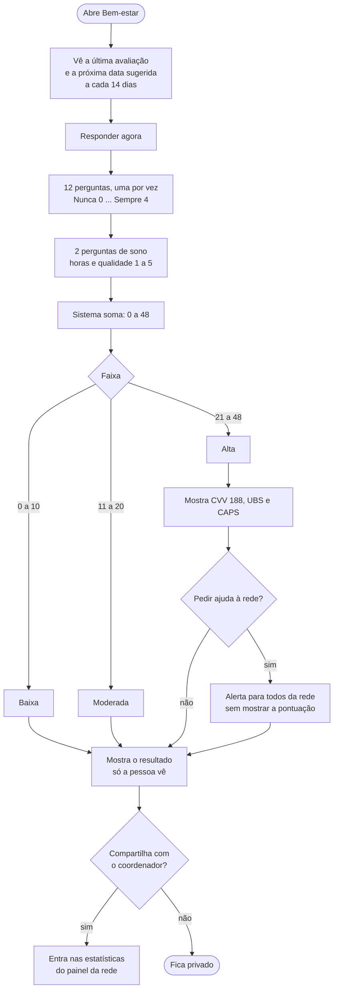

# Fluxo — Bem-estar e pedido de ajuda

> **Versão 1 (planejada) — 13/11/2026.** Ver [[Casos de Uso]] (UC15), [[Escala Zarit]] e [[LGPD, Segurança e Acessibilidade]].

## Privacidade
- O resultado é **privado por padrão**.
- **Consentimento 1:** compartilhar a pontuação com o coordenador, por rede. Só assim entra no painel.
- **Consentimento 2:** pedir ajuda, que gera um alerta sem a pontuação.
- A pessoa pode **apagar** qualquer avaliação. Ao excluir a conta, as avaliações são apagadas de verdade.
