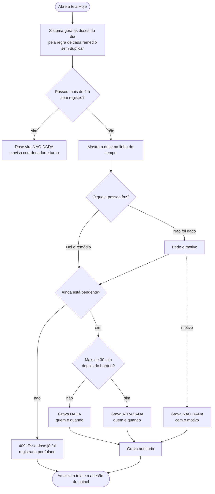

# Fluxo — Dar o remédio

> **Versão 1 (planejada) — 13/11/2026.** Diagrama de atividades (Fase 2: "Diagramas para simplificar fluxos"). Ver [[Casos de Uso]] (UC10 e UC11), [[Regras de Negócio]] e [[Arquitetura]] (sequência detalhada).

## Regras envolvidas
| Regra | Valor |
|---|---|
| Dose no horário | Registrada até **30 min** depois do previsto |
| Dose atrasada | Registrada **mais de 30 min** depois |
| Dose não dada | Marcada como não dada, ou **sem registro 2 h** depois do previsto |
| Registro duplo | Só a primeira pessoa grava (`UPDATE ... WHERE status = 'PENDENTE'`) |
| Fora do turno | Qualquer membro pode registrar a qualquer hora |
