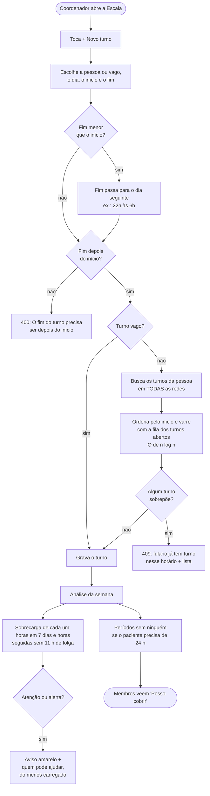

# Fluxo — Montar a escala

> **Versão 1 (planejada) — 13/11/2026.** Ver [[Casos de Uso]] (UC03 e UC14), [[Regras de Negócio]] e a nota da função [[conflitos]].

## Regras envolvidas
| Regra | Valor |
|---|---|
| Folga | Pelo menos **11 h** sem turno (referência: CLT, art. 66) |
| Atenção | Mais de **44 h** em 7 dias ou mais de **24 h** seguidas |
| Alerta | Mais de **60 h** em 7 dias ou mais de **36 h** seguidas |
| Conflito | Um turno começa antes de o outro terminar; turnos encostados não conflitam |
| Quem cria turno | O coordenador, para qualquer membro; o membro, só para si mesmo (cobrir vago) |
