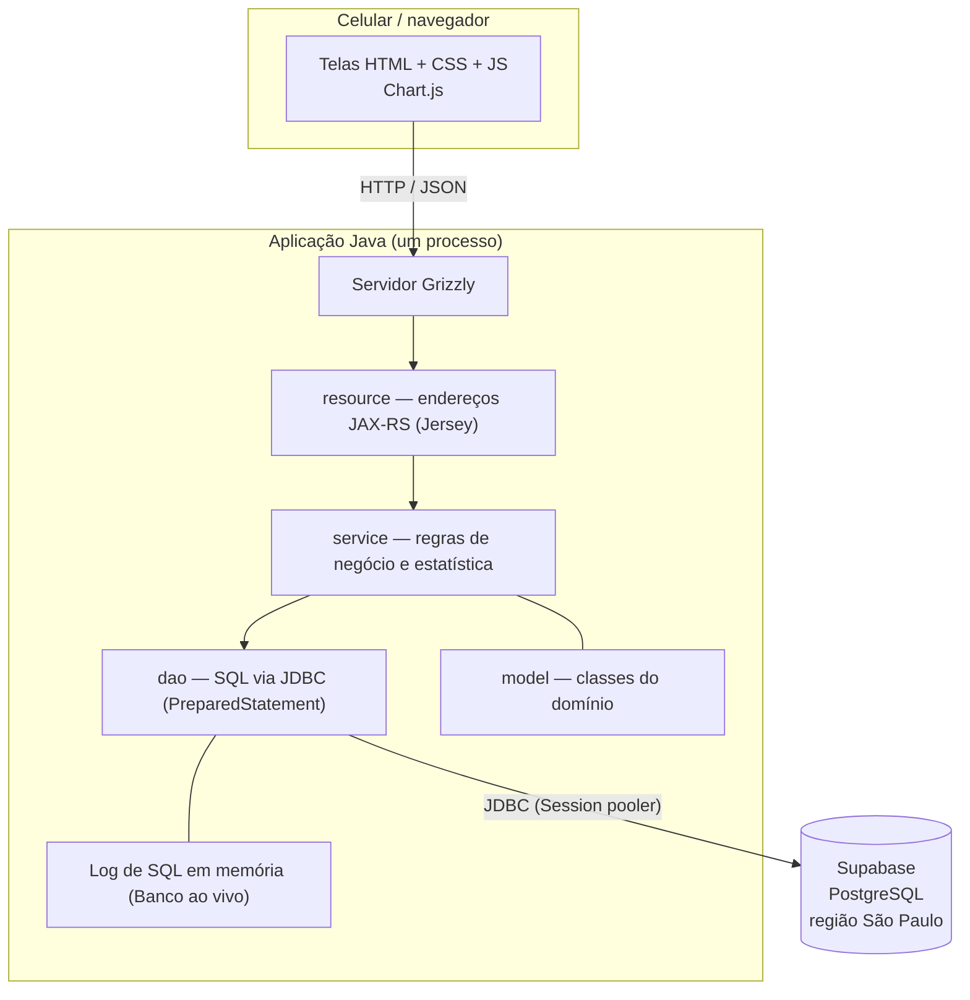

# Design da Solução — CuidaQuemCuida

> Rede de apoio e revezamento para cuidadores familiares.
> **"Os apps que existem cuidam do paciente. O CuidaQuemCuida cuida também de quem cuida."**

Documento base do projeto da Global Solution 2º semestre/2026 (tema **CitizenTech**). É a versão 1, escrita antes do código. As mudanças durante o desenvolvimento ficam registradas em [[Registro de Decisões]], e a versão final é comparada a esta na entrega.

---

## 1. Por que este projeto existe

### O problema
Milhões de pessoas cuidam sozinhas de um familiar acamado, com Alzheimer ou com deficiência severa. Elas sofrem com:
- **exaustão extrema** (sobrecarga do cuidador), sem ninguém medir ou perceber;
- **falta de orientação técnica básica**, como evitar escaras ou administrar horários complexos de medicação;
- **cuidado mal dividido**: familiares e vizinhos até querem ajudar, mas não há um jeito simples de combinar quem fica quando.

### Para quem
- **Cuidador principal**, na maioria das vezes uma mulher, filha ou esposa, de 45 a 65 anos, que usa principalmente o celular.
- **Rede de apoio**: outros familiares, netos e vizinhos voluntários que cobrem turnos.
- **Paciente**: pessoa dependente que **não usa o sistema**, mas é quem recebe o benefício.

### Evidências
- **IBGE, PNAD Contínua 2022:** as mulheres dedicam em média **21,3 h/semana** a afazeres domésticos e cuidado de pessoas, contra **11,7 h dos homens**, quase o dobro. O IBGE mede cuidado e afazeres juntos, então o dado deve ser citado assim.
- **Escala Zarit:** é o instrumento validado no Brasil para medir a sobrecarga do cuidador (Scazufca, 2002). A versão curta de 12 itens (ZBI-12) tem estudo brasileiro de 2019 com cuidadores idosos.
- **Pesquisa de concorrentes** (seção 16): nenhuma solução encontrada junta o revezamento entre familiares, a rotina de cuidado e a medição da sobrecarga de quem cuida.
- **Validação própria:** aplicar a ZBI-12 num formulário a cuidadores reais conhecidos da equipe e registrar o resultado (seção 12).

Detalhes em [[Problema e Evidências]] e [[Personas]].

---

## 2. Objetivos, não-objetivos e anti-objetivos

### Objetivos
1. **Nota máxima** na avaliação técnica e **competitividade** na disputa de melhor ideia da turma.
2. Cumprir **todos os itens do edital ao pé da letra**: protótipo funcional em Java, banco de dados, estatística, métodos ágeis, documentação (diagramas, wireframes, especificações, outros materiais) e os dois vídeos.
3. Uma solução **completa**: os 7 módulos da seção 4 funcionando de ponta a ponta. Completa, mas sem ser hipercomplexa.
4. **Facilitar a gravação dos vídeos**: dados de demonstração estáveis, tela "Banco ao vivo" e tela "Dados coletados".
5. Ligar o projeto aos **conteúdos do ano letivo** (seção 15).

### Não-objetivos
- App nativo nas lojas (seção 17): fica no roadmap.
- Notificação push, SMS ou WhatsApp: os alertas aparecem dentro do sistema.
- Acesso para profissional de saúde ou UBS: roadmap.
- Integração com dispositivos IoT de sinais vitais: roadmap.
- Diagnóstico ou recomendação médica: o sistema **orienta e organiza, não diagnostica**.

### Anti-objetivos (fracasso mesmo funcionando)
- Interface que uma cuidadora de 60 anos não consiga usar no celular.
- Dado de saúde exposto: sem perfil de acesso, sem hash de senha, banco acessível pela API pública do Supabase.
- Documentação que não bate com o que foi implementado. O edital avalia essa coerência.
- Registros falsos de agilidade (datas inventadas) ou desafios técnicos inventados no vídeo.

---

## 3. Restrições

| Restrição | Valor |
|---|---|
| Prazo de entrega | **19/11/2026**, sem entrega atrasada (senão vira prova substitutiva) |
| Equipe | 2 pessoas: Luis e Gabriel Vilela (papéis na seção 13) |
| Máquinas de desenvolvimento | **PC 1 (atual): sem Java e sem possibilidade de instalar.** Aqui se faz tudo o que não precisa de Java: documentação, diagramas, scripts SQL e telas com dados de demonstração, que já rodam no navegador. O código Java pode ser escrito aqui, mas é compilado e testado no PC 2. **PC 2 (casa):** IntelliJ IDEA Community com JDK 21 e Maven, para compilar, testar, ligar ao Supabase e trocar as telas do modo demonstração para a API real |
| Ações pendentes da equipe | Criar o projeto pessoal no Supabase e colocar o texto de conexão no arquivo de configuração; instalar o JDK e o Maven; aplicar a ZBI-12 a cuidadores reais; gravar os vídeos; criar o repositório no GitHub, se for usado |
| Linguagem obrigatória | Java (o edital pede "o sistema Java em funcionamento") |
| Vídeos | Pitch de até 3 min (competição) e técnico de até 3 min (nota), publicados no YouTube |
| Entrega | `.zip` na plataforma FIAP ON com os links dos vídeos (`.txt`) e a documentação |
| Controle do projeto | Tudo documentado em `.md` no **Obsidian**, ligado por `[[links]]` |

---

## 4. O sistema: perfis e módulos

### 4.1 Perfis
| Perfil | Quem | O que pode |
|---|---|---|
| **Coordenador** | Normalmente o cuidador principal | Tudo do paciente: cadastra paciente, remédios, faixas de sinais vitais e tarefas; convida e remove membros; monta a escala; vê o painel estatístico |
| **Membro** | Familiar ou vizinho voluntário | Vê a escala, assume turno vago, pede troca; no próprio turno registra dose, sinal vital e tarefa; vê do paciente só o necessário para cuidar (remédios e tarefas do dia, alertas) |
| (Paciente) | Pessoa cuidada | Não entra no sistema. O consentimento é dado pelo **responsável legal** |

- **Cada pessoa tem o próprio login**, porque o sistema precisa saber quem deu o remédio, quem fez o turno e quem está sobrecarregado.
- **Uma pessoa pode estar na rede de mais de um paciente**, como o vizinho que ajuda duas famílias. Isso vira uma associação N:N entre pessoa e paciente, com o papel de cada um.
- **O resultado da Zarit é privado por padrão.** Só quem respondeu vê. A pessoa tem dois consentimentos separados, que pode ligar e desligar a qualquer momento, **por rede**:
  1. **"Compartilhar minha pontuação com o coordenador"**: só assim ela entra nas estatísticas do painel. O painel mostra "N de M pessoas compartilharam".
  2. **"Pedir ajuda à rede"**: oferecido quando a faixa é alta; gera o alerta "preciso de ajuda" para todos da rede.

### 4.1.1 Como alguém entra na rede
1. O coordenador cria o paciente. O sistema gera um **código de convite** de 6 caracteres para aquela rede, que pode ser renovado.
2. A pessoa convidada cria a **própria conta**, aceita o **próprio termo** e digita o código: entra como MEMBRO. O coordenador pode promover alguém a coordenador ou remover da rede.
3. Ninguém cria conta por outra pessoa, porque cada um precisa aceitar o próprio termo.

### 4.1.2 Consentimento pelo paciente
O paciente não tem login. Ao cadastrá-lo, o coordenador informa:
- quem é o **responsável legal**: ele mesmo, ou outra pessoa, com nome e parentesco;
- uma declaração de que tem autorização dele para registrar os dados de saúde.

O registro guarda quem declarou, a versão do termo, a data e o nome do responsável. O responsável legal não precisa de login.

### 4.2 Módulos
1. **Cadastros:** pessoas, paciente (condição, data de nascimento, se precisa de acompanhamento 24 h, responsável legal) e membros da rede (papel e vínculo: familiar, vizinho ou amigo).
2. **Escala de revezamento:** turnos com início e fim. O sistema detecta:
   - conflito de horário da mesma pessoa;
   - período descoberto do paciente que precisa de 24 h;
   - sobrecarga.
   
   Também **sugere quem pode cobrir** um turno vago (as pessoas com menos horas na semana e sem conflito).
3. **Medicação:** remédio, dose, via e instruções, com regras de horário complexas:
   - intervalo fixo (de 8 em 8 horas);
   - horários fixos (8h e 20h);
   - dias alternados;
   - período de início e fim.
   
   O sistema gera as **doses previstas**. Na dose, a pessoa marca "Dei o remédio" ou "Não foi dado" com um motivo. Status possíveis: pendente, dada no horário, dada com atraso, não dada.
4. **Sinais vitais:** pressão (sistólica e diastólica), glicemia, temperatura, saturação e frequência cardíaca. Cada paciente tem uma faixa de alerta configurável, além da detecção de valor **fora da curva** em relação ao histórico do próprio paciente.
5. **Protocolo de cuidado:** tarefas recorrentes, como mudar de posição a cada 2 horas para evitar escara, higiene e hidratação. Cada uma tem uma **orientação curta de como fazer** e entra num checklist por turno.
6. **Bem-estar do cuidador:** ZBI-12, com 12 perguntas de 0 a 4 e total de 0 a 48, respondida uma pergunta por vez. São sugeridos **a cada 14 dias**, mas pode ser respondido a qualquer momento. Tem mais duas perguntas sobre o sono, fora da pontuação Zarit: horas dormidas e qualidade de 1 a 5. No risco alto, o sistema mostra onde buscar ajuda (CVV 188, UBS de referência, CAPS) e oferece compartilhar o alerta com a rede.
7. **Painel estatístico:** os indicadores da seção 6, com gráficos.

**Registro fora do turno:** qualquer membro da rede pode registrar dose, sinal vital e tarefa **a qualquer hora**. Na vida real, o turno acaba e o remédio sai 10 minutos depois. O registro guarda quem fez e quando, e a auditoria mostra.

**Tela "Hoje" sem turno em andamento:** mostra o **próximo turno** da pessoa e as pendências do dia do paciente (doses, tarefas e medições). Se a pessoa está em mais de uma rede, o topo tem um seletor de paciente, que guarda o último escolhido.

**Alertas** (aparecem no topo de cada tela e no "Hoje"). São calculados **quando a tela é aberta**, sem rotina rodando em segundo plano, e gravados com chave única (tipo, referência, destinatário) para o "lido" funcionar.

| Alerta | Quem recebe |
|---|---|
| Dose próxima, atrasada ou não dada; tarefa atrasada | Quem está de turno e o coordenador |
| Sinal vital fora da faixa ou fora da curva | Quem está de turno e o coordenador |
| Turno vago | Coordenador e todos os membros (alguém pode assumir) |
| Conflito de turno | A pessoa do conflito e o coordenador |
| Sobrecarga (horas) | A própria pessoa e o coordenador. As horas já são visíveis na escala; não é dado de saúde |
| "Preciso de ajuda" | Todos da rede (só quando a pessoa escolhe compartilhar) |

**Telas de apoio aos vídeos e à LGPD:**
- **Dados coletados:** cada dado guardado, por que é coletado, quem pode ver e por quanto tempo.
- **Banco ao vivo:** os últimos comandos SQL executados pelo sistema, com o tipo (inserção, leitura, alteração, exclusão) e o tempo. Fica guardado só na memória, até uns 50 comandos.

---

## 5. Regras de negócio

| Regra | Definição (v1) |
|---|---|
| **Conflito de turno** | Dois turnos da mesma pessoa cujos intervalos se sobrepõem (início de um < fim do outro). Turnos que atravessam a meia-noite (22h às 6h) são guardados com data e hora completas de início e fim, nunca só a hora |
| **Algoritmo de conflito** | Ordenar os turnos pelo início e comparar cada um com o maior fim visto até ali: O(n log n). A versão ingênua, que compara todos contra todos em O(n²), fica documentada como o "antes" (desafio técnico, ligado à Fase 6) |
| **Período descoberto** | Para paciente marcado como 24 h, qualquer intervalo da semana sem nenhum turno vira um turno vago sugerido |
| **Folga** | Intervalo de **pelo menos 11 h** sem turno para a pessoa. A referência é o descanso mínimo entre jornadas da CLT (art. 66) |
| **Horas seguidas sem folga** | Soma de turnos consecutivos da mesma pessoa separados por menos de 11 h |
| **Sobrecarga** | Atenção: mais de 44 h na janela móvel de 7 dias ou mais de 24 h seguidas sem folga. Alerta: mais de 60 h em 7 dias ou mais de 36 h seguidas. Os limites ficam numa classe de constantes para ajuste |
| **Sugestão de cobertura** | Membros ativos sem conflito no horário, do menos para o mais carregado em horas nos últimos 7 dias |
| **Dose atrasada** | Dada mais de 30 min depois do previsto |
| **Dose não dada** | Marcada como "não foi dado" ou sem registro 2 h depois do previsto |
| **Pontuação Zarit** | Soma dos 12 itens (0 a 48). O protótipo usa faixa baixa até 10, moderada de 11 a 20 e alta acima de 20. A versão brasileira e o corte de triagem sugerido no estudo estão em [[Escala Zarit]] |
| **Fora da curva (sinal vital)** | Com pelo menos 7 medições do mesmo tipo, valor com \|z\| > 2 em relação à média e ao desvio padrão do próprio paciente. Vale além da faixa fixa configurada |

Detalhes em [[Regras de Negócio]].

---

## 6. Estatística

O cálculo fica em dois lugares, para mostrar os dois conteúdos do curso.

| Indicador | Onde | Conteúdo do curso |
|---|---|---|
| Média móvel de 7 dias das horas de cuidado por pessoa | Java | Fase 1: média |
| Horas seguidas sem folga (máximo e atual) | Java | Fase 1 |
| Taxa de adesão: doses dadas no horário ÷ doses previstas, por remédio e por período (manhã, tarde, noite, madrugada) | **SQL** (`GROUP BY`) | Fase 6: agrupamentos, totais e métricas |
| Quem carrega o cuidado: % das horas de cada pessoa | **SQL**, com junções | Fases 5 e 6 |
| Equilíbrio da rede: desvio padrão e coeficiente de variação das horas entre os membros | Java | Fase 2: "Spreadable data" |
| Média, mediana e moda: horas por turno, horário com mais atrasos, pontuação Zarit | SQL e Java | Fase 1: "Está na média ou na moda?" |
| Chance de atraso: P(dose atrasada \| turno noturno) contra P(dose atrasada \| turno diurno) | Java | Fase 2: "Qual é a chance de...?" |
| Correlação de Pearson: turnos noturnos × pontuação Zarit e × qualidade do sono. **Unidade:** cada avaliação Zarit (pessoa × os 14 dias antes dela). **Turno noturno:** cobre pelo menos 3 h entre 22h e 6h. Conta os turnos da pessoa em todas as redes, porque é a carga dela. **Só entram as avaliações compartilhadas com o coordenador** | Java | Fase 1 |
| Sinal vital fora da curva (z-score) | Java | Fase 5: "É fora da curva!" |
| Pessoa com mais horas que a média da rede | **SQL** (subconsulta) | Fase 6: subconsultas |

As estatísticas da Zarit (média, mediana, moda e correlação) usam **só as avaliações compartilhadas**. O painel mostra quantas pessoas compartilharam. Na família fictícia da demonstração, todos compartilham.

Os dados do painel na demonstração são **simulados e declarados como simulados**. A simulação é montada para contar a história real do problema: o cuidador principal com cerca de 60% da carga, e turnos noturnos ligados a uma Zarit mais alta e a um sono pior.

Detalhes em [[Estatística]].

---

## 7. Arquitetura



| Decisão | Escolha | Por quê |
|---|---|---|
| Linguagem | Java 17 ou mais novo, com Maven | Exigência do edital; Maven organiza as dependências |
| API | JAX-RS com **Jersey + Grizzly** | É o que o curso ensinou (Fase 5, Cap 7). O Grizzly sobe pelo `main`, sem servidor para instalar |
| JSON | Jackson, integrado ao Jersey | Padrão da dupla Jersey e Jackson |
| Telas | HTML, CSS e JS puros, servidos pelo mesmo Grizzly | Fase 4 (front-end não integrado). Um endereço só evita problema de CORS |
| Gráficos | Chart.js | Simples e leve; Fase 1 ("Benditos gráficos") |
| Banco | **PostgreSQL no Supabase**, projeto pessoal e gratuito, região São Paulo | A dupla acessa de qualquer lugar; o painel web mostra os dados entrando no vídeo; dado de saúde guardado no Brasil (argumento de LGPD) |
| Acesso ao banco | **Somente pelo Java, via JDBC** com `PreparedStatement` | O vídeo técnico mostra o Java fazendo as requisições. `PreparedStatement` impede injeção de SQL (Fase 3, cybersecurity). A API automática do Supabase **não** é usada |
| Conexão | Texto de conexão "Session pooler" do Supabase | A conexão direta do plano gratuito só funciona em IPv6 |
| Segurança no Supabase | **RLS ligado em todas as tabelas, sem política** | Fecha a API automática para a chave pública. O Java entra com o usuário do banco e não é afetado |
| Segredos | Senha do banco num arquivo de configuração **fora do Git** (ou em variável de ambiente) | Não vazar credencial no GitHub |
| Senhas dos usuários | Hash **PBKDF2WithHmacSHA256** com salt, da própria biblioteca padrão do Java | Sem dependência extra; recomendação da OWASP |
| Login | Token aleatório por sessão, guardado no banco e mandado no cabeçalho `Authorization` | Simples e suficiente para o protótipo |
| Testes | JUnit 5 nas regras de negócio e na estatística | Evidência de "testado ou validado" no edital |

Os detalhes de cada camada, classe e função ficam nas notas de módulo e de classe (ver [[Mapa do Projeto]]).

---

## 8. Modelo de dados (v1, proposta)

O DER planejado fica em [[Diagrama do Banco]]. O final é gerado do banco real pelo **DBeaver**. Tabelas propostas:

| Tabela | Conteúdo principal |
|---|---|
| `pessoa` | nome, e-mail (único), hash e salt da senha, telefone, data de nascimento, gênero (opcional, com consentimento, usado só em estatística agregada ligada ao ODS 5) |
| `paciente` | nome, data de nascimento, condição, precisa de 24 h, observações, nome e parentesco do responsável legal (que não precisa ter login), código de convite |
| `membro_rede` | **associativa N:N** pessoa × paciente: papel (COORDENADOR ou MEMBRO), vínculo, ativo, desde quando |
| `consentimento` | quem, sobre qual paciente, versão do termo, aceito em |
| `turno` | paciente, pessoa (vazio = vago), início, fim (com data e hora), status |
| `medicamento` | paciente, nome, dosagem, via, instruções, ativo |
| `regra_horario` | medicamento, tipo (INTERVALO, HORARIOS_FIXOS ou DIAS_ALTERNADOS), parâmetros, início e fim |
| `dose` | medicamento, previsto para, dada em, dada por, status, motivo/observação |
| `sinal_vital` | paciente, tipo, valor (e valor 2 para a pressão), medido em, medido por |
| `faixa_sinal` | paciente, tipo, mínimo e máximo |
| `tarefa_cuidado` | paciente, título, orientação, recorrência em horas, primeira vez, tipo de sinal (preenchido quando a tarefa é uma medição, como "Medir pressão"), ativa |
| `execucao_tarefa` | tarefa, prevista para, feita em, feita por |
| `avaliacao_zarit` | pessoa, respondida em, pontuação, faixa, horas de sono, qualidade do sono, compartilhada |
| `resposta_zarit` | avaliação, número do item (1 a 12), valor (0 a 4) |
| `alerta` | paciente, pessoa destinatária, tipo, mensagem, criado em, lido em |
| `auditoria` | quem, ação, tabela, id do registro, quando, detalhe (Fase 5: auditoria de sistemas) |
| `sessao` | token, pessoa, expira em |

Regras do banco: chaves estrangeiras, `CHECK` nos domínios (status, valores de 0 a 4, fim > início), `UNIQUE` no e-mail e no par pessoa × paciente, e índices nas buscas por paciente e período. A normalização segue o conteúdo da Fase 3 ("Aprendendo a armazenar de maneira correta").

### Modelo orientado a objetos (pontos que vão para o vídeo)
- **Herança:** `Pessoa` (abstrata: nome, data de nascimento) → `Cuidador` (tem login) e `Paciente`.
- **Polimorfismo:** `Alerta` (abstrata, com `mensagem()` e `prioridade()`) → `AlertaMedicacao`, `AlertaSobrecarga`, `AlertaSinalVital`, `AlertaTurnoVago`, `AlertaPedidoAjuda`.
- **Polimorfismo 2:** `RegraHorario` (abstrata, com `gerarDoses(periodo)`) → `RegraIntervalo`, `RegraHorariosFixos`, `RegraDiasAlternados`.
- **Encapsulamento:** atributos privados, validação no construtor e nos setters (por exemplo, a dose não aceita "dada em" antes de "previsto para").
- **Enums:** `Papel`, `StatusDose`, `TipoSinal`, `FaixaZarit`.

---

## 9. API (v1, lista de recursos)

O construtor define os nomes finais. Cobertura mínima:

| Recurso | Operações |
|---|---|
| `/api/auth` | login, logout |
| `/api/pessoas` | cadastro com aceite do termo, meus dados, excluir minha conta |
| `/api/pacientes` | CRUD; `/{id}/membros` (convidar, mudar papel, remover) |
| `/api/turnos` | CRUD por paciente e semana; assumir turno vago; conflitos; sugestão de cobertura |
| `/api/medicamentos` e regras | CRUD |
| `/api/doses` | doses do dia; marcar dada ou não dada |
| `/api/sinais-vitais` e faixas | CRUD |
| `/api/tarefas` e execuções | CRUD; marcar feita |
| `/api/zarit` | responder; meu histórico; compartilhar alerta |
| `/api/hoje` | tudo do turno atual da pessoa logada, numa chamada |
| `/api/alertas` | listar e marcar como lido |
| `/api/estatisticas/{pacienteId}` | indicadores da seção 6 (só coordenador) |
| `/api/demo/sql` | últimos comandos SQL (Banco ao vivo) |

Toda rota, menos login e cadastro, exige token. Toda rota de paciente confere se a pessoa é membro daquela rede, e as de coordenador conferem o papel. Inserção, alteração e exclusão gravam em `auditoria`. Erros voltam em JSON com mensagem em português simples.

---

## 10. Telas (celular primeiro)

A maioria vai usar no **celular**, em pé, ao lado do paciente. No computador, a mesma tela se adapta: a barra inferior vira menu lateral.

**Barra inferior com 4 abas:** Hoje · Escala · Bem-estar · Mais.

| Tela | Conteúdo |
|---|---|
| Login e cadastro | Com o termo de consentimento destacado |
| **Hoje** (abre aqui) | Alertas no topo; "seu turno"; linha do tempo das doses, tarefas e medições do turno, cada uma com um botão ("Dei o remédio", "Feito", "Registrar") e "como fazer" nas tarefas |
| **Escala** | Semana com navegação; turno vago destacado; aviso de sobrecarga com sugestão de cobertura; criar, editar e assumir turno |
| **Bem-estar** | ZBI-12 uma pergunta por vez, marcada como "só você vê"; resultado com histórico; ajuda e compartilhamento no risco alto |
| **Mais** | Painel da rede (coordenador), paciente e remédios, pessoas da rede, sinais vitais, tarefas de cuidado, Dados coletados, Banco ao vivo, sair |

Esboços aprovados na conversa de design (13/11): a direção "celular primeiro", com as telas Hoje, Escala, Bem-estar e Mais. Eles são a base dos wireframes em [[Wireframes]].

**Acessibilidade:**
- texto base de pelo menos 18 px;
- alvos de toque de pelo menos 48 px;
- contraste nível AA;
- ícone sempre com texto;
- rótulos nos campos;
- navegação por teclado;
- linguagem simples em português ("Dei o remédio", não "Registrar administração").

---

## 11. Segurança, LGPD e acessibilidade

| Tema | Medida |
|---|---|
| Base legal | **Consentimento específico e destacado** para dado de saúde (LGPD art. 11, I), dado pelo usuário e, para o paciente, pelo **responsável legal**. Fica registrado em `consentimento` |
| Necessidade | O membro vê só o necessário para o turno; a Zarit é privada |
| Transparência | Tela "Dados coletados", com o prazo de guarda de cada dado (tabela abaixo) |
| Direitos do titular | Ver os meus dados e excluir a minha conta |
| Exclusão de conta | **Anonimização**: nome vira "Pessoa removida"; e-mail, telefone, senha e data de nascimento são apagados; o login é desativado. Os registros de cuidado (dose "dada por", turnos, medições) continuam, apontando para a pessoa anonimizada, o que a LGPD permite para dado anonimizado (art. 16). As **avaliações Zarit da pessoa são apagadas de fato**. Um coordenador só exclui a conta depois de passar a coordenação a outro membro. Se for o último membro, os dados do paciente são apagados junto |
| Localização | Dados no Brasil (Supabase, região São Paulo) |
| Senhas | PBKDF2 com salt; nunca guardadas em texto |
| Injeção de SQL | Só `PreparedStatement` |
| Banco | RLS ligado; credencial fora do Git |
| Rastreabilidade | Tabela `auditoria` |
| Aviso | "O CuidaQuemCuida organiza e orienta. Não substitui orientação médica." |
| Zarit | Escala com direitos autorais, de uso livre para pesquisa acadêmica sem financiamento: é o caso deste protótipo, e isso fica registrado |
| Produção (roadmap) | HTTPS e hospedagem; a demonstração roda localmente |

**Prazo de guarda (aparece na tela "Dados coletados"):**

| Dado | Guardado por |
|---|---|
| Cadastro da pessoa | Enquanto a conta existir |
| Dados de cuidado do paciente (doses, sinais, tarefas, turnos) | Enquanto a rede existir |
| Avaliações Zarit | Até a pessoa apagar a avaliação ou excluir a conta |
| Sessão de login | 7 dias |
| Auditoria | 6 meses (referência: Marco Civil da Internet, art. 15, registros de acesso a aplicações) |
| Banco ao vivo | Só na memória; some ao reiniciar o sistema |

Ligação com os conteúdos: Fase 3 (cybersecurity, ISO 27000, direito digital) e Fase 5 (LGPD, auditoria). Detalhes em [[LGPD, Segurança e Acessibilidade]].

---

## 12. Validação e testes

1. **Testes automáticos (JUnit)** nas regras. Cenários mínimos:
   - turno que atravessa a meia-noite com conflito;
   - turnos encostados que somam mais de 24 h sem folga;
   - regra de 8 em 8 horas gerando as doses certas num período;
   - dias alternados;
   - dose dada aos 31 min (atrasada) e aos 29 min (no horário);
   - pontuação e faixa da Zarit;
   - z-score com menos de 7 medições (não alerta);
   - Pearson com dados conhecidos;
   - sugestão de cobertura ordenada pela carga.
2. **Cenários de aceite manuais** por história de usuário, com resultado esperado e obtido, em [[Testes e Validação]].
3. **Validação com pessoas:** a ZBI-12 aplicada num formulário a cuidadores reais conhecidos da equipe, mais um teste de uso rápido no celular com 1 ou 2 pessoas (conseguiu marcar o remédio sem ajuda?). Os resultados são reais e registrados com a data.
4. **Métricas de sucesso do produto** (para o pitch): adesão à medicação, redução das horas seguidas sem folga do cuidador principal, equilíbrio da carga entre os membros, evolução da pontuação Zarit.

---

## 13. Métodos ágeis (Scrum enxuto)

| Fase | Datas | Entregas |
|---|---|---|
| Descoberta | ~09/11 a 12/11 (aproximado) | Escolha e análise das ideias (inclusive Xepa Solidária × CuidaQuemCuida) |
| Sprint 0, planejamento | 13/11 | Este documento, pesquisa de concorrentes, esboços das telas, backlog |
| Sprint 1, fundação | 14 e 15/11 | Banco, classes, DAO, login, cadastros, escala com conflito |
| Sprint 2, cuidado | 16 e 17/11 | Medicação, sinais vitais, tarefas, Zarit, tela Hoje, alertas |
| Sprint 3, painel e entrega | 18/11 | Estatística e painel, testes, diagramas e documentação finais, gravação dos vídeos |
| Entrega | 19/11 | Revisão, `.zip` e envio |

- **Backlog** em histórias de usuário ("Como membro da rede, quero marcar que dei o remédio para que todos saibam que já foi dado").
- **Quadro Kanban no GitHub Projects** (ou um quadro Kanban em nota do Obsidian, se o GitHub não for usado). Cada cartão registra o responsável e quem aprovou. Os prints entram na documentação.
- **Rituais registrados no Obsidian**: planejamento, daily curta escrita, revisão e retrospectiva de cada sprint.
- **Papéis:**

| Papel | Quem | Faz |
|---|---|---|
| Product Owner | Luis | Define e prioriza o backlog, aprova cada entrega, valida com cuidadores reais, vídeo pitch |
| Scrum Master e validação | Gabriel Vilela | Conduz os rituais, testa o sistema no celular, vídeo técnico |

  As notas técnicas (uma por módulo, classe e função) são a base para explicar o código no vídeo técnico.
- **Datas sempre reais.** O histórico do Git e do Kanban é a evidência.

### 13.1 Ordem de construção (prioridade)
Tudo está planejado. A ordem garante que, **no fim de cada dia, exista um sistema que roda e pode ser mostrado**.

| Prioridade | Itens |
|---|---|
| **1. Núcleo** (sem isso não há vídeo técnico) | Banco e scripts; login, cadastro e convite; paciente e rede; escala com conflito; medicação com geração de doses e "Dei o remédio"; tela Hoje; Zarit; Banco ao vivo; Dados coletados; testes JUnit das regras do núcleo; dados de demonstração |
| **2. Completo** | Sinais vitais com faixa; tarefas de cuidado; alertas; painel com adesão, quem carrega, média móvel, equilíbrio, média/mediana/moda e Pearson; sugestão de cobertura; auditoria; excluir conta |
| **3. Acabamento** | Período descoberto automático; fora da curva; chance de atraso noturno × diurno; graphify; PDF montado das notas |

Se o tempo apertar, a prioridade 3 sai primeiro, e cada item cortado entra no roadmap e na retrospectiva, de forma honesta.

Ligação: Fase 1 ("Framework ágil: Scrum na prática"). Detalhes em [[Métodos Ágeis]].

---

## 14. Documentação e entrega

- **Vault do Obsidian = pasta `C:\CuidaQuemCuida`.** Uma nota por módulo, classe e função com regra de negócio, ligadas por `[[links]]`, para gerar um grafo rico. Getters e setters não ganham nota.
- **Diagramas em Mermaid dentro das notas.** Para a entrega, viram PNG e SVG em `documentacao/01-diagramas/`. A versão 1 (planejada) e a versão final vão as duas.
- **Diagramas exigidos e previstos:**
  - arquitetura;
  - banco (DER);
  - classes;
  - casos de uso, com fichas no formato do Lab da Fase 2;
  - fluxos (atividades): marcar dose, montar escala com conflito, Zarit até o pedido de ajuda.
- **graphify:** rodado no fim, sobre o código pronto, como material extra. A pasta de saída dele fica fora do vault.
- **Pastas excluídas do vault e do zip:** `.superpowers/` (rascunhos) e a configuração do Obsidian.

```
CuidaQuemCuida/
├── codigo/                          aplicação Java (Maven)
├── banco/                           scripts SQL: criação, RLS, dados de demonstração, reset
├── documentacao/
│   ├── Mapa do Projeto.md           nota-índice do vault
│   ├── 01-diagramas/
│   ├── 02-wireframes/
│   ├── 03-especificacoes-tecnicas/  este documento, API, regras, módulos, classes, funções
│   └── 04-outros-materiais/         evidências, personas, concorrentes, ODS, LGPD, ágil, testes,
│                                    estatística, diário de desafios, registro de decisões,
│                                    conteúdos do curso
├── videos/                          roteiros + links.txt
└── Documentacao-CuidaQuemCuida.pdf  montado no fim a partir das notas
```

### O que vai no `.zip`
O edital pede, no zip, **os links dos dois vídeos e a documentação**. A nota sai dos vídeos e da documentação; o edital não pede que o avaliador rode o sistema. Mesmo assim, vão também, para provar a coerência:
- o código-fonte (ou o link do GitHub, se o repositório for público na entrega);
- um `README.md` com como rodar;
- os scripts SQL, que funcionam em qualquer PostgreSQL.

A senha do Supabase **não** vai. Quem quiser rodar usa um PostgreSQL próprio, seguindo o README.

Cuidado: o plano gratuito do Supabase pausa o projeto depois de uma semana sem uso. Basta acessar antes de gravar; se pausar, reativa pelo painel.

### Checklist do edital
O texto completo está em [[Edital GS 2026]]. Cada item tem dono no plano:

| Item do edital | Onde é atendido |
|---|---|
| Público, contexto e dificuldade | Seção 1, [[Personas]], pitch |
| Como o problema foi identificado e evidências | Seção 1, [[Problema e Evidências]], [[Concorrentes]] |
| Como a solução funciona e o benefício | Seções 4 e 10, pitch |
| Tecnologias com justificativa | Seção 7 |
| Como o protótipo foi testado e como medir resultados | Seção 12 |
| Acessibilidade, inclusão, segurança e dados | Seções 10 e 11 |
| ODS com a relação explicada | Seção 16 |
| Critério: criatividade e inovação | Seção 16 (diferencial) |
| Critério: coerência das tecnologias | Seção 7 |
| Critério: protótipo mínimo funcional | Sistema Java (seção 13.1, prioridade 1) |
| Critério: vídeo pitch | Roteiro abaixo |
| Critério: banco de dados | Seção 8, DER |
| Critério: análise e interpretação estatística | Seção 6, painel |
| Critério: métodos ágeis | Seção 13 |
| Vídeo técnico: Java rodando, CRUD, dados coletados, conteúdos, desafios | Roteiro abaixo |
| Documentação: diagramas, wireframes, especificações, outros materiais | Pastas 01 a 04 |
| Entrega: `.zip` com os links em `.txt` | `videos/links.txt` |

### Vídeo pitch (até 3 min, competição)
Problema com história e dado do IBGE → solução → diferencial contra os concorrentes → ODS → validação → roadmap (app nas lojas, pulseira IoT, integração com UBS) → chamada final. Usar textos, infográficos, imagens reais e roadmap, como o edital pede. **Não mostra implementação.**

### Vídeo técnico (até 3 min, nota)
Roteiro com marcação de tempo, cobrindo cada item do edital:
1. sistema Java rodando no modo celular;
2. inserção, leitura, alteração e exclusão com o **Banco ao vivo** e a tabela do Supabase atualizando;
3. **Dados coletados** e como são tratados;
4. conceitos com trechos de código: classes e herança, polimorfismo do `Alerta`, DAO com JDBC e `PreparedStatement`, recurso JAX-RS, diagrama de classes e DER;
5. 1 ou 2 desafios técnicos **reais** do diário, com a solução;
6. testes JUnit passando.

### Diário de desafios
Cada problema real vira uma entrada: o problema, o que tentamos, o que decidimos e o trecho de código. Nada é inventado. **Previstos**, para acompanhar:
- turno que atravessa a meia-noite;
- conflito de O(n²) para O(n log n);
- gerar doses de regras complexas sem duplicar;
- juntar turnos encostados no cálculo de folga;
- a conexão IPv4 do Supabase;
- os dados simulados contarem uma história coerente.

---

## 15. Ligação com os conteúdos do ano letivo

| Fase | Conteúdo | Onde aparece |
|---|---|---|
| 1 Agile | Scrum na prática | Sprints, backlog, Kanban, rituais |
| 1 | Desvendando a cabeça do usuário | Personas e jornada do cuidador |
| 1 | Gráficos; média e moda | Painel estatístico |
| 2 OOP | Casos de uso e Lab de casos de uso | Diagrama e fichas |
| 2 | Diagramas de fluxo | Fluxos da aplicação |
| 2 | Diagrama de classes; classes, métodos, "quando as partes se conversam" | Modelo do domínio |
| 2 | Spreadable data; "Qual é a chance de...?" | Equilíbrio da rede; chance de atraso |
| 3 DB | Encapsulamento, herança, polimorfismo | `Pessoa`, `Alerta`, `RegraHorario` |
| 3 | Modelo entidade-relacionamento, modelagem avançada, normalização, estruturas físicas, SQL | DER, N:N `membro_rede`, DDL com restrições |
| 3 | Cybersecurity, ISO 27000, direito digital | Hash, perfis, RLS, `PreparedStatement`, consentimento |
| 4 Prototyping | Interfaces gráficas front-end não integrado | Telas HTML, CSS e JS |
| 4 | Java consulta o Oracle (JDBC); inserção, atualização e exclusão | Camada DAO (no PostgreSQL, com o mesmo JDBC) |
| 5 | API RESTful e JAX-RS (Jersey + Grizzly) | Camada resource |
| 5 | "É fora da curva!" | Z-score dos sinais vitais |
| 5 | LGPD; auditoria de sistemas | Dados coletados, consentimento, tabela `auditoria` |
| 5 e 6 | SQL: filtros, junções, agrupamentos, subconsultas | Consultas do painel |
| 6 | Eficiência (Big O), ordenação | Algoritmo de conflito |
| 6 | IoT | Roadmap: pulseira de sinais vitais |

Ficam de fora de propósito: blockchain, redes, engenharia social, recursão e árvores. A justificativa da troca de Oracle por PostgreSQL está na seção 7.

---

## 16. Concorrentes e diferencial (pesquisa de 13/11/2026)

| Solução | Faz | Não faz |
|---|---|---|
| Lotsa Helping Hands (EUA) | Calendário de voluntários, lembretes, mural | Medicação, sinais vitais, sobrecarga do cuidador; só em inglês |
| App Cuidar (Brasil) | Rotina, medicação, sinais vitais, escalas de dependência do paciente | Mede o paciente, não o cuidador; não faz revezamento |
| Alzheimer.App | Vários familiares no mesmo perfil | Escala de turnos |
| O Cuidador (cuidaemcasa) | Escala de rodízio 12x36 | É para empresas de home care, não para famílias |
| Saúde da Pessoa Idosa (UNA-SUS/MS) | Tem a Escala Zarit | É para profissionais; não organiza turnos |
| Humanis (Brasil) | Orienta o cuidador por uma persona virtual | Escala e medicação |

**Diferencial:** é o único que junta revezamento entre família e vizinhos, rotina de cuidado e **medição da sobrecarga de quem cuida**, e ainda mostra quem carrega o peso do cuidado. Detalhes e fontes em [[Concorrentes]].

### ODS
- **ODS 3, Saúde e Bem-Estar:** adesão à medicação, prevenção de escara, alerta de sinal vital e saúde mental do cuidador.
- **ODS 5, Igualdade de Gênero:** o cuidado não remunerado recai sobre as mulheres (IBGE). O painel "quem carrega o cuidado" torna isso visível e ajuda a redistribuir.
- **ODS 10, Redução das Desigualdades:** famílias que não podem pagar um cuidador profissional ganham uma ferramenta gratuita, que roda no navegador de qualquer celular sem instalar nada.

Detalhes em [[ODS]].

---

## 17. Por que web e não app nas lojas

**O ideal seria um app nativo na App Store e na Google Play**: notificação push confiável, ícone na tela inicial, uso sem conexão. Para o protótipo, a escolha foi **web responsiva, pensada primeiro para o celular**, por custo e prazo:
- a conta de desenvolvedor da Apple custa US$ 99 por ano, e a da Google, uma taxa única de US$ 25;
- seriam dois apps para desenvolver e manter, além do processo de revisão das lojas;
- o prazo é de 6 dias, e o edital exige o sistema em Java.

A versão web roda em qualquer celular pelo navegador, sem instalar nada, o que também reforça o ODS 10. **A API REST em Java já está pronta para servir um app futuro sem mudar o back-end:** o app nativo seria só uma nova tela sobre a mesma API.

**Roadmap:** a web responsiva já dispõe de manifesto e ícone para instalação como PWA em navegadores compatíveis. A instalação fora do ambiente local requer publicação em HTTPS. O app nativo nas lojas é a etapa seguinte.

---

## 18. Roadmap (para o pitch)
1. App nativo (App Store e Google Play) com notificação push.
2. Lembrete por WhatsApp.
3. Pulseira ou aparelhos IoT enviando os sinais vitais sozinhos.
4. Acesso de leitura para enfermeiro ou UBS (relatório para a consulta).
5. Conteúdo de orientação ampliado (vídeos curtos de técnicas de cuidado).
6. Rede de voluntários do bairro (encontrar quem pode ajudar perto).

---

## 19. Decisões tomadas na Sprint 0 (para conferir)
- Supabase em vez do Oracle da FIAP, com a justificativa da seção 7.
- ZBI-12 a cada 14 dias, com duas perguntas de sono fora da pontuação.
- Limites de folga e sobrecarga (11 h; 44 e 60 h por semana; 24 e 36 h seguidas) e tolerâncias da dose (30 min e 2 h).
- Z-score com |z| > 2 e mínimo de 7 medições.
- Login próprio por pessoa, com dois perfis; Zarit privada com compartilhamento opcional.
- PBKDF2 da biblioteca padrão para as senhas; login por token.
- Tabelas da seção 8 e hierarquias de classes da seção 8.
- Cronograma das sprints e a ordem de prioridade da seção 13.
- Diagramas em Mermaid e DER final pelo DBeaver.
- Zarit com dois consentimentos separados e estatísticas só com as avaliações compartilhadas; unidade e definição de "turno noturno" na correlação.
- Entrada na rede por código de convite; consentimento do paciente declarado pelo coordenador, com o nome do responsável legal.
- Registro permitido fora do turno; "Hoje" sem turno mostra o próximo turno e as pendências do dia.
- Destinatários de cada alerta; alertas calculados quando a tela abre.
- Exclusão de conta por anonimização; prazos de guarda da seção 11.
- Código e README no zip, sem a senha do banco.

## 20. Deixado para o construtor
- Colunas e tipos exatos, nomes de índices e restrições.
- Nomes finais das rotas e formato do JSON.
- Visual (cores, tipografia) dentro das regras de acessibilidade da seção 10.
- Faixas intermediárias da Zarit, com a fonte citada.
- Como os dados de demonstração são gerados, desde que sejam determinísticos (sempre o mesmo resultado ao resetar) e contem a história da seção 6.
- Família fictícia da demonstração (sugestão: Dona Lurdes, 82 anos, Alzheimer; Marta, filha e coordenadora; Paulo, filho; Ana, neta; Seu João, vizinho).
- Como o PDF final é montado a partir das notas.
